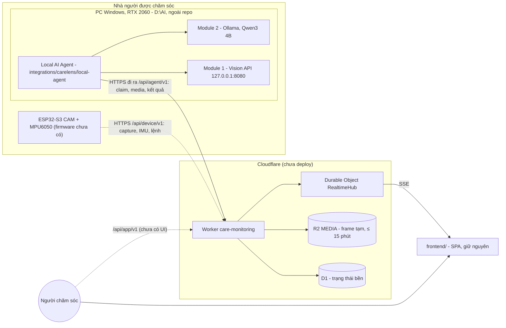
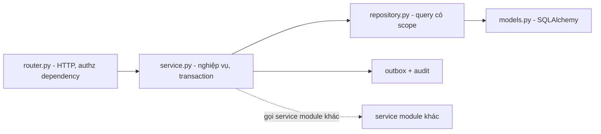
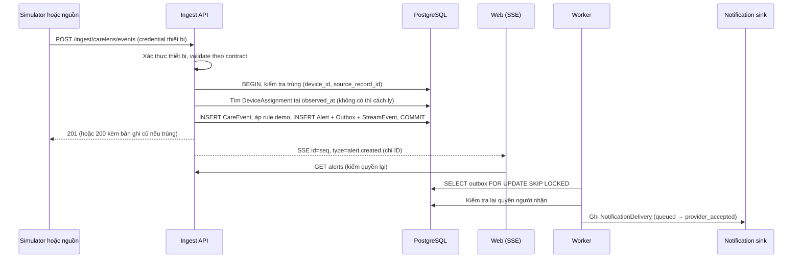
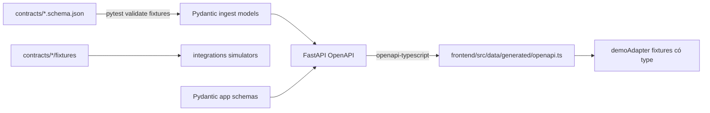

# Kiến trúc kỹ thuật — CareLens + EcoPatch Webapp

Phiên bản: 0.1  
Ngày: 2026-09-14  
Trạng thái: **Accepted** (người dùng duyệt ADR-002…ADR-010 ngày 2026-09-14). Riêng chữ trắng trên nút primary trong ADR-009 còn Open.  
Cập nhật 2026-10-19 (ADR-015, Proposed): CareLens AI là hệ thống dùng thật; backend EcoPatch, Firebase và Telegram đã gỡ. Cập nhật tiếp 2026-10-19 (ADR-016, ADR-017, D10, Proposed): `backend/care-monitoring` là Cloudflare Worker + D1 + R2 + Durable Object, agent cục bộ ở `integrations/carelens/local-agent` (§6.7). Cập nhật lần 3 cùng ngày (ADR-017 sửa, ADR-018, ADR-019, A33, A34, Proposed): hợp nhất trên IMU thô và đồng hồ thiết bị, hợp đồng thiết bị v2, đăng nhập web + vé stream; Live Demo của frontend nối backend ở lớp dữ liệu, giao diện giữ nguyên.

Tài liệu này chuyển `docs/IMPLEMENTATION_PLAN.md` §4, §5, §8–§11 thành kiến trúc cụ thể để scaffold và phát triển. Nghiệp vụ, quyền và nghiệm thu vẫn lấy từ plan. Khi mâu thuẫn, plan thắng và mâu thuẫn được ghi vào `docs/DECISIONS.md`.

## 1. Động lực kiến trúc

| Động lực | Hệ quả thiết kế |
| --- | --- |
| Ranh giới riêng tư CareLens: frame chỉ tồn tại tạm thời để suy luận (D10, Proposed) | Frame chỉ qua API upload thiết bị vào R2 riêng tư, xóa sau suy luận hoặc tối đa 15 phút. Không có đường ảnh trong D1, API người chăm sóc, log, webapp |
| Quyền theo từng hồ sơ | Lớp authz tập trung ở backend, query có scope trong SQL, test cách ly bắt buộc |
| Trình bày dữ liệu trung thực | `observed_at`/`received_at`, `last_seen`, trạng thái nguồn là dữ liệu hạng nhất |
| Chưa có thiết bị đã xác minh | Ingest có xác thực là đường duy nhất vào backend. Dữ liệu tổng hợp chỉ ở test. UI đọc qua `DataAdapter` |
| Cảnh báo không mất, không trùng | Transactional outbox, idempotency, optimistic version |
| Nhóm nhỏ, lịch 6–8 tuần | Modular monolith, ít hạ tầng: một API, một worker, một PostgreSQL |

## 2. Bối cảnh hệ thống



Nét đứt là đường đã có API nhưng chưa có client thật (firmware, UI). Cảnh báo đi Vision → Worker (quyết định hợp nhất + cảnh báo trong một giao dịch) → SSE, không qua Module 2. Frame chỉ nằm tạm trong R2 riêng tư (D10, Proposed).

## 3. Chế độ triển khai

| Chế độ | Mô tả | Trạng thái |
| --- | --- | --- |
| Local một máy | Web (`npm run dev`), Worker qua `wrangler dev` với D1/R2/DO cục bộ (`npm run dev:backend`), agent + Module 1/2 ở `D:\AI` | Đã kiểm chứng 2026-10-19 (test e2e) |
| Cloudflare + PC tại nhà | Worker trên Cloudflare, agent trên PC gọi ra ngoài, frontend trên Vercel | Cấu hình sẵn, chưa deploy (cần tài khoản, owner đồng ý) |
| Tích hợp thiết bị | ESP32 thật gửi capture/IMU, nhận lệnh | Chưa có firmware, chờ D02, D09 |

Không deploy public ở chế độ demo.

## 4. Stack đề xuất

Phiên bản cụ thể chọn khi scaffold (bản ổn định được hỗ trợ tại thời điểm đó), khóa trong lockfile, `.nvmrc` và `.python-version`.

| Lớp | Lựa chọn | Lý do | ADR |
| --- | --- | --- | --- |
| Web | React + TypeScript strict + Vite, SPA | App đăng nhập không cần SSR. Landing cùng bundle để dùng chung design system | ADR-002 |
| Routing, server state | React Router, TanStack Query | Route theo plan §6. Cache key có `recipientId`, hủy request khi đổi hồ sơ | ADR-002 |
| Styling | Tailwind CSS v4, token trong `@theme` | Design system gốc viết bằng utility Tailwind. Một nguồn token | ADR-004 |
| Form | React Hook Form + Zod | Validation gắn với label và field | ADR-002 |
| Icon, biểu đồ | lucide-react, Recharts (chốt ở M2) | Icon Menu/X theo spec. Biểu đồ hỗ trợ khoảng trống dữ liệu | ADR-002 |
| API | Python + FastAPI + Pydantic v2 | Theo plan §4.1, cùng ngôn ngữ với khối AI CareLens, OpenAPI tự sinh | ADR-002 |
| ORM, migration | SQLAlchemy 2 + Alembic, psycopg 3 | Transaction, row locking, constraint rõ ràng | ADR-002 |
| Database | PostgreSQL | Exclusion constraint, `SKIP LOCKED`, `LISTEN/NOTIFY` | ADR-002 |
| Worker | Tiến trình Python riêng đọc outbox | Không cần Redis/Celery ở quy mô demo | ADR-005 |
| Realtime | SSE mang gợi ý thay đổi | Đơn giản, replay bằng `Last-Event-ID`, không mang dữ liệu sức khỏe | ADR-010 |
| Auth | Session phía server, cookie httpOnly, CSRF, argon2 | Plan §10. Thu hồi phiên tức thì | ADR-006 |
| Contracts | JSON Schema trong `contracts/`, OpenAPI → openapi-typescript | Một nguồn schema, type web sinh tự động | ADR-007 |
| Quản lý gói | npm workspaces, uv workspace | npm có sẵn. uv có lockfile và quản lý phiên bản Python | ADR-003 |
| Chất lượng | ESLint + Prettier + tsc, ruff + pyright | | ADR-002 |
| Test | Vitest + Testing Library, pytest + Postgres thật, Playwright | Plan §13 | ADR-002 |

## 5. Cấu trúc repo

```
IStartup/
├─ AGENTS.md  CLAUDE.md  README.md
├─ package.json            npm workspaces + script điều phối (dev, test, lint, demo:reset)
├─ pyproject.toml          uv workspace: backend/api, integrations/*
├─ docker-compose.yml      PostgreSQL cho dev và test
├─ .env.example
├─ frontend/
│  ├─ src/
│  │  ├─ app/              router, providers, AppShell, route guards
│  │  ├─ design-system/    tokens.css, primitives
│  │  ├─ features/<domain>/ màn hình và component nghiệp vụ
│  │  ├─ data/             DataAdapter, httpAdapter, demoAdapter, generated/, queryKeys, sse
│  │  └─ lib/              định dạng thời gian, tiện ích a11y
│  └─ package.json
├─ backend/
│  ├─ api/
│  │  ├─ app/
│  │  │  ├─ main.py
│  │  │  ├─ core/          config, db, security, errors, logging, clock
│  │  │  ├─ authz/         permission, dependency kiểm quyền
│  │  │  ├─ modules/<domain>/  router, schemas, service, repository, models
│  │  └─ worker/        outbox runner, escalation, export
│  │  ├─ alembic/
│  │  └─ tests/{unit,integration}/
│  └─ care-monitoring/     Cloudflare Worker (worker/: src, migrations, test), start_backend.py, scripts/ (§6.7, ADR-016)
├─ integrations/
│  └─ carelens/local-agent/  agent Python nối Vision (Module 1) và Ollama (Module 2) với Worker
├─ contracts/
│  ├─ carelens/care_event.v1.schema.json, fixtures/
│  └─ common/error.v1.schema.json
├─ tests/e2e/              Playwright
├─ docs/
└─ Carelens/  EcoPatch/    PRD gốc
```

## 6. Backend

### 6.1 Module và chiều phụ thuộc



- Router không truy vấn DB. Service không import FastAPI. Module khác chỉ gọi qua service, không đọc bảng của nhau.

| Nhóm | Module | Entity chính (plan §8.1) |
| --- | --- | --- |
| Danh tính và quyền | auth, households, recipients, grants, invitations, audit | User, Session, Household, Membership, CareRecipient, RecipientGrant, Invitation, ConsentRecord, AuditLog |
| Thiết bị | enrollments, devices, pairing, patches | ProductEnrollment, Hub/Device, DeviceCredential, DeviceAssignment, PairingChallenge, PatchSession |
| Dữ liệu nguồn | ingest, events, measurements | CareEvent, Measurement, WaveformSegment, QuarantinedRecord |
| Chăm sóc | alerts, notes, notifications, streams | Alert, AlertAction, NotificationDelivery, Outbox, StreamEvent, CareNote |
| Báo cáo | reports, exports | ExportJob |

### 6.2 Phân quyền

Backend kiểm tra **permission**, không kiểm tra tên vai trò. Vai trò ở plan §5 chỉ là bộ permission mặc định khi cấp grant. Bảng dưới là đề xuất, chốt ở M1.

| Vai trò | Permission mặc định |
| --- | --- |
| Người được chăm sóc | `recipient.read`, `data.read`, `sharing.manage` khi đủ điều kiện |
| Người quản lý nhóm | `recipient.manage`, `devices.manage`, `sharing.manage`. Không tự có `data.read` nếu chưa có đồng ý chia sẻ |
| Caregiver | `recipient.read`, `data.read`, `alerts.act`, `notes.write` |
| Viewer | `recipient.read`, `data.read` |
| Device operator | `devices.operate`, `ai_config.write` khi được cấp. Không có `data.read` |
| Platform admin | `platform.admin`. Không có `data.read` |

`exports.create` chỉ có khi được cấp tường minh.

Dependency `require_recipient(permission, product=None)` thực hiện: lấy session → tải grant còn hiệu lực (chưa thu hồi, chưa hết hạn) → kiểm enrollment nếu route thuộc một sản phẩm → trả context `{actor, recipient, permissions}`. Không có grant trả 404 để không lộ hồ sơ tồn tại. Có grant nhưng thiếu permission trả 403.

### 6.3 Luồng ingest → alert → thông báo



### 6.4 Bất biến được bảo vệ bằng database

| Bất biến | Cơ chế | AC |
| --- | --- | --- |
| Không trùng dữ liệu nguồn | `UNIQUE (device_id, source_record_id)` | AC04 |
| Chỉ một người tiếp nhận alert | `UPDATE … WHERE status = 'open' AND version = :v` | AC05 |
| Đóng alert phải có kết quả | `CHECK (status <> 'resolved' OR review_outcome IS NOT NULL)` | AC06 |
| Giá trị mới nhất đúng khi gói đến muộn | Chỉ cập nhật latest khi `observed_at` lớn hơn | AC08 |
| Không chồng khoảng gán thiết bị | `EXCLUDE USING gist (device_id WITH =, tstzrange(valid_from, valid_to) WITH &&)` (cần `btree_gist`) | AC09 |
| Một phiên patch đang hoạt động mỗi lõi | Partial unique index `WHERE ended_at IS NULL` | AC10 |
| Không mất thông báo khi worker dừng | Outbox ghi cùng transaction với alert | AC12 |

### 6.5 Stream

- Bảng `stream_events` có `seq bigserial`, `recipient_id`, `type`, `entity_id`, `created_at`. Không chứa dữ liệu sức khỏe.
- Client nhận gợi ý rồi refetch qua REST, nên quyền luôn được kiểm lại khi đọc.
- Reconnect gửi `Last-Event-ID`, server trả các `seq` lớn hơn. Bản ghi quá hạn giữ (cấu hình, ví dụ 24 giờ) thì client tải lại danh sách.
- Thu hồi grant phát `NOTIFY grant_revoked`. API đóng các stream đang mở của người bị thu hồi.

### 6.6 Lỗi, thời gian, cấu hình

- Lỗi trả `application/problem+json` gồm `type`, `title`, `status`, `detail`, `code`, `request_id`. Không lộ stack trace.
- Thời gian lưu `timestamptz` UTC. Server gán `received_at` qua clock inject được để test.
- Cấu hình qua biến môi trường với pydantic-settings. Mỗi biến mới có trong `.env.example`.
- Notification provider mặc định là `sink`. Provider thật chỉ bật qua cấu hình tường minh sau khi D09 được chốt.

### 6.7 `backend/care-monitoring` (ADR-016, Proposed)

Cloudflare Worker TypeScript, mã ở `backend/care-monitoring/worker`. Hợp đồng: `docs/API_CONTRACT.md`; giao thức thiết bị: `docs/DEVICE_API.md`; triển khai: `docs/DEPLOYMENT_RUNBOOK.md`. Đối chiếu với luồng §6.3:

| Bước §6.3 | care-monitoring |
| --- | --- |
| Xác thực thiết bị, validate | Token mỗi thiết bị (SHA-256 trong D1). zod strict, giới hạn kích thước. `device_id` trong payload phải trùng credential |
| Kiểm tra trùng | `(device_id, capture_id)`, `(device_id, boot_id, batch_seq)` của IMU, `trigger_id`, `idempotency_key` của agent và lệnh; cùng nội dung 200, khác nội dung 409 |
| `observed_at` của nguồn | Thiết bị gửi `clock{boot_id, uptime_ms}`; bằng chứng mang `uptime_ms`. Máy chủ ước lượng mốc boot = min(thời điểm nhận − uptime) và lưu cả đồng hồ thiết bị lẫn UTC ước lượng. Hợp nhất chỉ so `uptime_ms` trong cùng boot (ADR-019) |
| DeviceAssignment theo `observed_at` | Thiết bị gắn cố định một hồ sơ; đổi người thì cấp `device_id` mới |
| Lưu event + alert + outbox trong transaction | `db.batch()` (giao dịch D1) gồm sự kiện, quyết định hợp nhất, cảnh báo, lệnh còi, cập nhật job; bảng `tx_guard` hủy batch khi lease/trạng thái sai. Thay outbox: job bền trong D1 + Durable Object phát SSE sau commit |
| Rule cảnh báo | `fusion-rules.v2` (ADR-017): bằng chứng hình ảnh + IMU thô do backend đánh giá (độ phủ, cảm biến đứng yên, quy tắc đã duyệt, khớp thời gian). Kết quả `suspected_fall`, `needs_review`, `not_enough_data`, `no_fall_detected`, `processing_failed`. Chỉ `suspected_fall` tạo cảnh báo; không có cảnh báo đơn nguồn. Mặc định không quy tắc: không cảnh báo nghi ngã (D11) |
| Worker | Local AI Agent trên PC kéo job (claim nguyên tử, lease, retry, hết hạn theo media) |
| SSE | `RealtimeHub` (WebSocket hibernation) → Worker giữ SSE: gợi ý `{seq, type, entity_id}` cho `/api/app/v1/recipients/{id}/stream`; khung `state_update` đầy đủ cho `/api/demo/stream` của Live Demo, mở bằng vé dùng một lần sau khi đăng nhập (ADR-018, D12) |
| Xác thực web | ADR-006 (cookie) chưa áp dụng: đăng nhập bằng thông tin owner cấp → bearer token phiên trong bộ nhớ trình duyệt; vé `cls_` 60 s cho EventSource (ADR-018) |
| Lệnh thiết bị | `queued → delivered → accepted → started → completed` (+ `failed`, `rejected`, `expired`, `cancelled`, `superseded`); chỉ thiết bị chuyển sang trạng thái phát; âm thanh giao theo lệnh với `Range` và SHA-256 |
| Báo cáo ngày | Cron 00:15 Asia/Ho_Chi_Minh, job `daily_report`, số liệu tính ở backend, LLM chỉ tóm tắt; không nằm trên đường cảnh báo |
| Media | Frame chỉ trong R2 `MEDIA`, xóa sau suy luận, khi thất bại hẳn, hoặc khi hết `MEDIA_MAX_AGE_SECONDS` |

## 7. Frontend

### 7.1 Data layer

```ts
interface DataAdapter {
  readonly mode: "http" | "demo";
  getMe(): Promise<Me>;
  listRecipients(): Promise<RecipientSummary[]>;
  getOverview(recipientId: string): Promise<Overview>;
  listAlerts(recipientId: string, query: AlertQuery): Promise<Page<AlertRow>>;
  actOnAlert(recipientId: string, alertId: string, input: AlertActionInput): Promise<AlertDetail>;
  subscribe(recipientId: string, onHint: (hint: StreamHint) => void): () => void;
  // Bổ sung theo từng màn hình, type lấy từ data/generated/openapi.ts
}
```

- `httpAdapter` gọi `/api/app/v1` với cookie và header CSRF.
- `demoAdapter` dùng fixture tổng hợp trong bộ nhớ, reset được, mọi bản ghi có `source_mode: "simulated"`. Chỉ dùng cho landing preview và app shell trước khi có backend. Không bao giờ là fallback khi API lỗi.
- Adapter chọn lúc khởi động theo cấu hình build và được hiển thị rõ trên UI.
- Query key có dạng `["recipient", recipientId, resource, filters]`.

### 7.2 Đổi hồ sơ đang xem

Khi người dùng đổi hồ sơ: hủy request đang chạy → xóa cache `["recipient", oldId]` → đóng SSE cũ → đóng dialog/drawer → điều hướng → mở SSE mới. Response đến muộn của hồ sơ cũ bị bỏ qua.

### 7.3 Routing và guard

Route theo plan §6 và SYSTEM_UI_PROMPT (S01–S14). Ba lớp guard chỉ phục vụ trải nghiệm, bảo mật thật nằm ở server:

- **Auth guard:** phiên hết hạn → `/login?returnTo=…`.
- **Recipient guard:** 404/403 từ API → trạng thái forbidden, không hiện dữ liệu cũ.
- **Product guard:** hồ sơ chưa bật sản phẩm → không hiện tab, route trả trạng thái chưa kích hoạt kèm lý do.

### 7.4 Design system

Một nguồn token duy nhất tại `frontend/src/design-system/tokens.css`. Giá trị giữ nguyên từ design system gốc.

```css
@theme {
  --color-surface: #E0E5EC;
  --color-fg: #3D4852;
  --color-muted: #6B7280;
  --color-placeholder: #A0AEC0;
  --color-accent: #6C63FF;
  --color-accent-light: #8B84FF;
  --color-accent-secondary: #38B2AC;

  --font-display: "Plus Jakarta Sans", ui-sans-serif, system-ui, sans-serif;
  --font-sans: "DM Sans", ui-sans-serif, system-ui, sans-serif;

  --radius-container: 32px;
  --radius-control: 16px;
  --radius-inner: 12px;

  --shadow-extruded: 9px 9px 16px rgb(163,177,198,0.6), -9px -9px 16px rgba(255,255,255,0.5);
  --shadow-extruded-hover: 12px 12px 20px rgb(163,177,198,0.7), -12px -12px 20px rgba(255,255,255,0.6);
  --shadow-extruded-sm: 5px 5px 10px rgb(163,177,198,0.6), -5px -5px 10px rgba(255,255,255,0.5);
  --shadow-inset: inset 6px 6px 10px rgb(163,177,198,0.6), inset -6px -6px 10px rgba(255,255,255,0.5);
  --shadow-inset-deep: inset 10px 10px 20px rgb(163,177,198,0.7), inset -10px -10px 20px rgba(255,255,255,0.6);
  --shadow-inset-sm: inset 3px 3px 6px rgb(163,177,198,0.6), inset -3px -3px 6px rgba(255,255,255,0.5);
}
```

Primitives: `SoftSurface`, `SoftButton`, `InsetField`, `IconWell`, `SoftTabs`, `StatusLabel`, `Dialog`, `Drawer`, `EmptyState`, `InlineError`, `Skeleton`. Component nghiệp vụ nằm trong `features/`. Landing preview dùng lại component nghiệp vụ ở chế độ read-only.

Diễn giải motion theo ADR-008. Quy tắc tương phản theo ADR-009.

## 8. Contracts và luồng type



Hợp đồng nguồn hiện là **đề xuất của adapter** theo plan §8.3–§8.4, chưa xác minh với hub hay thiết bị.

## 9. Chiến lược kiểm thử

| Tầng | Công cụ | Nội dung | AC |
| --- | --- | --- | --- |
| Unit API | pytest | State machine alert, rule demo, validation, escape CSV | AC06 |
| Integration API | pytest + PostgreSQL Docker | Authz, dedup, gói đến muộn, gán thiết bị, tiếp nhận đồng thời, retry thay patch, outbox restart, thu hồi quyền với stream | AC01, AC03–AC05, AC08–AC12, AC17, AC18 |
| Contract | pytest + jsonschema | Fixture khớp Pydantic | AC04, AC15 |
| Unit web | Vitest + Testing Library | Chọn state, nhãn, định dạng thời gian, không vẽ metric thiếu | AC07, AC14 |
| E2E | Playwright | Kịch bản demo plan §14, responsive, bàn phím, reconnect | AC02, AC13, AC15 |
| Rà tĩnh | `/guardrail-check`, grep trong CI | Không có đường ảnh vào webapp | AC16 |

## 10. Bảo mật và riêng tư tối thiểu

- Cookie httpOnly, SameSite=Lax, Secure ngoài localhost. CSRF token cho mọi mutation. Giới hạn thử đăng nhập.
- Credential thiết bị lưu dạng hash, scope theo thiết bị. Token lời mời lưu hash, dùng một lần, có hạn.
- Ghép thiết bị cần challenge. QR hoặc serial không đủ (AC17).
- Export kiểm quyền khi tạo và khi tải, escape ô bắt đầu bằng `=`, `+`, `-`, `@`.
- Không cache phản hồi sức khỏe bằng service worker. Logout xóa cache TanStack Query.
- Log có cấu trúc kèm `request_id`, lọc token, cookie, payload sức khỏe.
- Frame CareLens: chỉ API upload thiết bị → R2 riêng tư, tạm thời; agent tải bằng lease token, xử lý trong bộ nhớ, ghi đè bộ đệm, dọn predictor của Vision server bằng khung trung tính; không vào D1, log, export (D10, Proposed). Vision API và Ollama chỉ nghe loopback.

## 11. Chủ động không làm

- Microservices, Kubernetes, Redis, Celery, Kafka.
- Next.js hoặc SSR.
- Web Bluetooth trong trình duyệt.
- ~~Đồng bộ event CareLens lên cloud~~: người dùng chọn kiến trúc cloud ngày 2026-10-19 (D10, ADR-016, Proposed).
- Thư viện i18n. App chỉ có tiếng Việt, nhãn tập trung trong `features/<domain>/labels.ts`.
- Dark mode, theme riêng theo sản phẩm.
- Component library lớn trước vertical slice.

## 12. Hạng mục kỹ thuật còn mở

| Hạng mục | Liên quan | Cần trước |
| --- | --- | --- |
| Cách truy cập từ xa hub CareLens (VPN, tunnel, relay) | D01 | M5 |
| Danh tính và quyền giữa hub local và backend | D01 | M5 |
| Firmware ESP32 theo hợp đồng `/api/device/v1` và kiểm thử thiết bị thật | D10, ADR-016 | Tích hợp thật |
| Ngưỡng hiệu chỉnh hình ảnh, chính sách cảnh báo đơn nguồn | D11, ADR-017 | Cảnh báo nghi ngã thật |
| Đăng nhập web và adapter http thay `/api/demo/stream` không xác thực | ADR-006, D12 | Dùng qua mạng |
| Deploy Cloudflare (D1, R2, secret), gói Free hay Paid | ADR-016, A30 | Chạy thật |
| Nhà cung cấp thông báo, Web Push | D09 | M5 |
| Thời hạn lưu dữ liệu và waveform | D08 | Dữ liệu thật |
| Tương phản chữ trắng trên nút accent | ADR-009 | G1 ở M0 |
