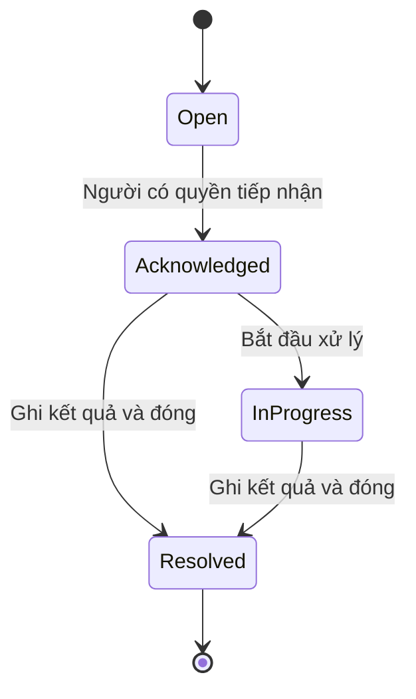

# Kế hoạch triển khai webapp CareLens và EcoPatch

Phiên bản: 1.2  
Ngày: 2026-09-14  
Trạng thái: Đề xuất triển khai; Neumorphism được chọn cho landing và UI hệ thống  
Vị trí đề xuất trong repo: `docs/IMPLEMENTATION_PLAN.md`

## 1. Mục tiêu và cách sử dụng

Xây một webapp hỗ trợ sử dụng thiết bị, theo dõi thông tin và quản lý dữ liệu cho CareLens và EcoPatch. Lấy **người được chăm sóc** làm trung tâm: một hồ sơ có thể dùng một hoặc cả hai sản phẩm, có nhiều người chăm sóc và một trung tâm cảnh báo chung.

Tài liệu này chuyển kế hoạch sản phẩm thành hướng dẫn triển khai. Đây không phải xác nhận rằng phần cứng, AI hoặc API trong PRD đã hoạt động. Chưa kiểm tra source code hay thiết bị thực tế của hai dự án.

Cập nhật v1.2: người dùng yêu cầu UI hệ thống đồng bộ với phong cách Neumorphism của landing. Hướng A/B cũ được thay thế. Dùng `CARELENS_ECOPATCH_LANDING_PROMPT.md` cho landing và `CARELENS_ECOPATCH_SYSTEM_UI_PROMPT.md` cho 14 nhóm màn hình hệ thống; bộ design system gốc được giữ nguyên trong cả hai prompt. Đây là cập nhật đặc tả, chưa phải bằng chứng code UI đã được triển khai.

Coding agent bắt đầu bằng kiểm tra repo, sau đó triển khai từng mốc có thể chạy và nghiệm thu. Khi thiếu thiết bị hoặc hợp đồng API, dùng adapter mô phỏng có nhãn rõ ràng; không tự bịa dữ liệu thật, ngưỡng y khoa hoặc năng lực dự đoán bệnh.

### 1.1 Tài liệu nguồn

| Tài liệu | Phạm vi được dùng |
| --- | --- |
| `PRD_CareLens_AI.docx` | Khối AI tại local hub, care event, API dự kiến, yêu cầu riêng tư |
| `PRD_CareLens_AI_EN.docx` | Bản tiếng Anh để đối chiếu cùng nội dung CareLens |
| `PRD_EcoPatch_VI.docx` | Lõi IoT, miếng dán, BLE, dữ liệu sinh hiệu, mobile/cloud |
| `PRD_EcoPatch_EN.docx` | Bản tiếng Anh để đối chiếu cùng nội dung EcoPatch |

Hai PRD đều là bản nháp. CareLens PRD tập trung Layer 2 AI, chưa phải đặc tả webapp. Các yêu cầu về hồ sơ, phân quyền, dữ liệu chung và nghiệp vụ cảnh báo dưới đây là đề xuất bổ sung.

Nếu PRD chưa có trong repo, ghi nhận nguồn còn thiếu và tiếp tục phần demo theo tài liệu này. Không tự tạo liên kết giả hoặc tuyên bố đã đọc file không có.

### 1.2 Quy tắc cho coding agent

1. Đọc hướng dẫn repo, cấu trúc hiện tại, manifest, API, schema, migrations và test trước khi sửa.
2. Giữ stack và conventions hiện có khi phù hợp; không dựng lại ứng dụng hoặc thay backend chỉ để khớp tên công nghệ trong kế hoạch.
3. Phân biệt ba trạng thái: **yêu cầu từ PRD**, **đề xuất trong tài liệu**, **khả năng đã được kiểm tra trong code/thiết bị**.
4. Thực hiện theo mốc ở mục 12; cập nhật checklist, cách chạy và hạn chế sau mỗi mốc.
5. Ghi quyết định kỹ thuật có ảnh hưởng vào `docs/DECISIONS.md`. Không coi vấn đề chưa chốt là đã được người dùng phê duyệt.
6. Không commit secrets, dữ liệu sức khỏe thật hoặc ảnh/video của người dùng. Dùng fixtures tổng hợp cho phát triển.
7. Không tự triển khai public, gửi thông báo tới người thật hoặc bật nhà cung cấp trả phí chỉ để chứng minh demo hoạt động.
8. Chỉ hỏi khi thiếu thông tin thực sự chặn phần công việc tiếp theo. Các hạng mục độc lập và demo tiếp tục được triển khai.

## 2. Phạm vi và nguyên tắc sản phẩm

### 2.1 Phần chung

- Tài khoản, đăng nhập/đăng xuất và quản lý phiên.
- Nhóm gia đình, hồ sơ người được chăm sóc, lời mời và quyền trên từng hồ sơ.
- Kích hoạt CareLens/EcoPatch theo hồ sơ và khả năng thiết bị.
- Ghép thiết bị, hướng dẫn sử dụng, kiểm tra kết nối, trạng thái pin khi nguồn có cung cấp.
- Trung tâm cảnh báo, phân công tiếp nhận, phản hồi và ghi nhận xử lý.
- Ghi chú chăm sóc, lịch sử, báo cáo và xuất CSV theo quyền.
- Cài đặt thông báo, đồng ý chia sẻ, nhật ký thay đổi và chính sách dữ liệu.

### 2.2 Module CareLens

- Timeline care event: thời điểm, nguồn thiết bị, mô tả AI, mức cảnh báo gốc.
- Chi tiết sự kiện, trạng thái xử lý và phản hồi đúng/sai/chưa xác định.
- Trạng thái hub, kết nối camera, lần đồng bộ cuối và tình trạng dịch vụ AI.
- Cấu hình AI dành cho người có quyền vận hành; tích hợp sau khi xác minh API.
- Không xây kho video, ảnh thumbnail từ camera hoặc chức năng xem lại footage.
- Không hiển thị điểm care level như xác suất bệnh hay phần trăm chính xác.
- Không tự bổ sung chức năng xác nhận uống thuốc chỉ vì bối cảnh PRD nhắc tới quên thuốc; cần đặc tả và nguồn sự kiện tương ứng.

### 2.3 Module EcoPatch

- Chỉ số gần nhất và biểu đồ lịch sử cho phép đo mà thiết bị thực sự hỗ trợ.
- ECG dạng sóng chỉ xuất hiện nếu có dữ liệu waveform và hợp đồng lấy mẫu rõ ràng.
- Chất lượng tín hiệu, mất tiếp xúc nếu thiết bị cung cấp, trạng thái kết nối/pin.
- Lịch sử thay miếng dán, ngày bắt đầu, ngày dự kiến thay và mã lô nếu có.
- Hướng dẫn gắn lại lõi, kiểm tra tín hiệu và ghi nhận phản hồi sử dụng.
- Không gắn nhãn GSR thành mức hydrat hóa hoặc điện giải nếu chưa có phương pháp chuyển đổi được kiểm chứng.

### 2.4 Chưa làm trong MVP

- Thanh toán, tự động gia hạn thuê bao, logistics và kho hàng đầy đủ.
- Tích hợp EHR/bệnh viện, cổng bác sĩ chuyên sâu.
- Chatbot tư vấn y khoa, tự thay đổi điều trị, dự đoán đột quỵ/mất nước chưa kiểm chứng.
- Điểm sức khỏe tổng hợp từ hai sản phẩm hoặc suy luận liên sản phẩm.
- Huấn luyện/fine-tune AI trên dữ liệu người dùng.
- Đa camera trong cùng một CareLens hub nếu backend hiện tại chưa hỗ trợ.
- Nhận diện khuôn mặt để tự gắn sự kiện với người.

### 2.5 Hai mốc sản phẩm khác nhau

| Mốc | Phạm vi | Không được tuyên bố |
| --- | --- | --- |
| Demo phần mềm | Dữ liệu tổng hợp, nghiệp vụ đầy đủ, notification sink nội bộ | Thiết bị hoặc mô hình thật đã được kiểm chứng |
| Tích hợp kỹ thuật | Kết nối nguồn thật đã xác minh, đo độ trễ và lỗi kết nối | Đủ điều kiện sử dụng y tế hoặc bảo đảm cảnh báo khẩn cấp |

## 3. Các quyết định chưa chốt và phương án tạm thời

| ID | Vấn đề | Mặc định cho demo | Điều kiện trước tích hợp thật |
| --- | --- | --- | --- |
| D01 | CareLens không cloud, EcoPatch có cloud | Một demo local với dữ liệu tổng hợp; tách adapter và kho dữ liệu theo module | Chốt ranh giới local/cloud, xác thực và truy cập từ xa |
| D02 | Camera đeo có quan sát được tư thế người đeo không? | Sự kiện mô phỏng gắn với hồ sơ rõ ràng | Xác minh góc nhìn và cách ánh xạ sự kiện; không đoán danh tính người trong ảnh |
| D03 | Điểm care level và độ trễ AI chưa có bằng chứng đánh giá trong file | Hiển thị điểm gốc như thông tin AI thử nghiệm | Đo trên cấu hình thật; xác nhận phiên bản mô hình và quy tắc cảnh báo |
| D04 | EcoPatch chưa có schema telemetry/BLE được cung cấp | Adapter mô phỏng theo schema đề xuất ở mục 8 | Chốt GATT, định dạng gói, đơn vị, tần suất, hiệu chuẩn và chất lượng tín hiệu |
| D05 | Dự đoán đột quỵ/mất nước chưa có kết quả kiểm chứng trong PRD | Không triển khai hoặc hiển thị như chức năng hoạt động | Có đặc tả và bằng chứng đánh giá phù hợp |
| D06 | Vòng đời 7–14 ngày không khớp gói 30 miếng/tháng | Cho nhập ngày dự kiến thay; chưa bán subscription | Chốt vòng đời sử dụng và quy cách bán, tách khỏi thời gian phân hủy |
| D07 | Chưa biết đội ngũ, deadline, code hiện có | Ưu tiên luồng demo xuyên suốt | Cập nhật ước lượng sau khảo sát repo |
| D08 | Chưa chốt thời hạn lưu và xóa dữ liệu thật | Chỉ dữ liệu tổng hợp; có tác vụ reset demo | Chốt thời hạn theo từng loại dữ liệu và cả bản sao lưu |
| D09 | Chưa có nhà cung cấp thông báo | Lưu notification vào sink nội bộ, không gửi ra ngoài | Cấu hình kênh, quyền người nhận, kiểm tra thiết bị và phương án dự phòng |

Không dùng việc thiếu D02–D06 để chặn phát triển giao diện và nghiệp vụ mô phỏng. Không bật tích hợp thật nếu quyết định liên quan chưa được giải quyết.

## 4. Kiến trúc đề xuất

### 4.1 Stack khi repo chưa có nền tảng

| Thành phần | Đề xuất |
| --- | --- |
| Web | React + TypeScript, giao diện responsive, chuẩn bị khả năng PWA |
| API nghiệp vụ | FastAPI nếu phù hợp khối AI Python hiện có |
| Database | PostgreSQL, migrations có version |
| Cập nhật khi web mở | SSE; dùng WebSocket nếu backend hiện tại đã cung cấp |
| Tác vụ nền | Worker cho outbox, retry, nhắc việc và xuất dữ liệu |
| AI | Tiến trình/dịch vụ riêng, kết nối qua adapter; không chạy suy luận nặng trong API web |
| Môi trường local | Cách chạy nhất quán bằng scripts hoặc container theo conventions repo |

Agent chọn phiên bản được hỗ trợ và tương thích tại thời điểm triển khai, ghi lockfile. Không suy ra phiên bản từ tài liệu này. Chưa cần Kubernetes hoặc nhiều microservice.

### 4.2 Ranh giới local và cloud

- CareLens: xử lý ảnh tại hub, ảnh không đi vào API nghiệp vụ, database, log hoặc analytics của webapp. Event CareLens mặc định lưu local.
- EcoPatch: lõi BLE cần điện thoại/gateway tiếp nhận; web nhận dữ liệu qua API. Không giả định mọi trình duyệt kết nối BLE liên tục được.
- Demo: cùng một web/API local và hai adapter mô phỏng. Cấu trúc này không tự giải quyết kết nối từ xa trong sản phẩm thật.
- Tích hợp thật: web dùng lớp truy cập dữ liệu theo deployment; CareLens có bản phục vụ tại hub, EcoPatch dùng endpoint được cấu hình.
- Màn hình tổng hợp phải thể hiện nguồn nào đang truy cập được. Nếu CareLens local không kết nối từ xa được, hiển thị trạng thái đó; không âm thầm upload dữ liệu để làm dashboard đầy đủ.
- Đồng bộ event CareLens ra cloud là một thay đổi phạm vi riêng: cần cập nhật PRD, đồng ý chia sẻ, danh sách trường được phép, thời hạn lưu và cơ chế thu hồi. Mặc định tắt.
- Phải chốt danh tính, ánh xạ hồ sơ và thực thi quyền ở từng backend trước khi kết hợp hai deployment thật. Không coi đăng nhập một nơi tự động cấp quyền ở nơi còn lại.
- Không mở thẳng cổng hub ra Internet. Giải pháp truy cập riêng, HTTPS và tương thích trình duyệt phải được thiết kế ở mốc tích hợp.

## 5. Vai trò và phân quyền

Quyền áp dụng theo `household_id` và `care_recipient_id`. Vai trò là bộ quyền mặc định; backend vẫn kiểm tra từng hành động, đối tượng và trạng thái quyền hiện tại.

| Vai trò | Quyền dự kiến | Giới hạn |
| --- | --- | --- |
| Người được chăm sóc | Xem hồ sơ của mình, xem và quản lý chia sẻ khi đủ điều kiện | Không mặc định phải có tài khoản hoặc tự thao tác thiết bị |
| Người quản lý nhóm | Quản lý thành viên, thiết bị, cấp quyền trong phạm vi được phép | Quyền quản lý nhóm không tự thay thế sự đồng ý chia sẻ |
| Caregiver | Xem hồ sơ được cấp, tiếp nhận cảnh báo, ghi kết quả và ghi chú | Không tự thay quyền hoặc cấu hình mô hình |
| Viewer | Xem dữ liệu được chia sẻ | Không xử lý cảnh báo, không xuất dữ liệu nếu chưa được cấp |
| Device operator | Xem chẩn đoán vận hành, ghép thiết bị, cấu hình được phép | Không tự có quyền đọc lịch sử sức khỏe |
| Platform admin | Vận hành tài khoản và hạ tầng | Không tự có quyền đọc dữ liệu sức khỏe |

Yêu cầu triển khai:

- User có thể thuộc nhiều nhóm; một hồ sơ có nhiều caregiver.
- Tách quản lý thành viên nhóm khỏi quyền đọc dữ liệu một người.
- Mọi list/detail/export/stream/mutation đều thực thi quyền phía server.
- Thiết bị/gateway dùng credential riêng, chỉ được gửi dữ liệu trong phạm vi đã gán; không dùng credential trình duyệt.
- Thu hồi quyền phải chặn API, export và stream đang mở; bỏ các thông báo chưa gửi cho người đã mất quyền.
- Lời mời dùng token hết hạn, một lần, xác minh người nhận khi chấp nhận. Token không ghi vào log.
- QR hoặc serial không đủ để chiếm quyền sở hữu thiết bị; có challenge xác minh với thiết bị/hub hoặc mã kích hoạt được bảo vệ.
- Nhật ký ghi người thực hiện, hành động, đối tượng, thời điểm và kết quả; không chứa secrets hoặc payload nhạy cảm đầy đủ.

## 6. Màn hình và trải nghiệm

Các đường dẫn là đề xuất, điều chỉnh theo router hiện có. `:recipientId` phải được kiểm tra quyền ở server.

| Route | Màn hình | Nội dung chính |
| --- | --- | --- |
| `/login` | Đăng nhập | Trạng thái lỗi rõ, không lộ tài khoản tồn tại |
| `/onboarding` | Bắt đầu | Tạo/chọn nhóm, hồ sơ, sản phẩm, thiết bị và thông báo thử |
| `/people` | Chọn hồ sơ | Chỉ người được cấp quyền |
| `/people/:recipientId/overview` | Tổng quan | Cảnh báo đang mở, cập nhật cuối, kết nối, việc cần làm |
| `/people/:recipientId/carelens` | CareLens | Timeline, lọc, trạng thái hub, chi tiết event |
| `/people/:recipientId/ecopatch` | EcoPatch | Chỉ số, chất lượng, khoảng thời gian, vòng đời miếng dán |
| `/people/:recipientId/alerts` | Cảnh báo | Mức độ, người phụ trách, trạng thái, lọc theo nguồn |
| `/people/:recipientId/alerts/:alertId` | Chi tiết cảnh báo | Nguồn, bằng chứng dạng dữ liệu, tiếp nhận, kết quả, cách xử lý |
| `/people/:recipientId/devices` | Thiết bị | Ghép, pin, kết nối, kiểm tra tín hiệu, hướng dẫn |
| `/people/:recipientId/history` | Lịch sử | Event, ghi chú, lần thay patch, hành động xử lý |
| `/people/:recipientId/reports` | Báo cáo | Tổng hợp theo thời gian và xuất CSV có quyền |
| `/people/:recipientId/sharing` | Chia sẻ | Người có quyền, lời mời, thu hồi, cài đặt liên quan |
| `/settings/notifications` | Thông báo | Kênh, quyền trình duyệt, nhận thử, người dự phòng |
| `/admin` | Vận hành | Trạng thái dịch vụ và hỗ trợ theo quyền riêng |

### Quy tắc UI bắt buộc

- Tiếng Việt là ngôn ngữ mặc định; identifier trong code dùng tiếng Anh.
- Chỉ hiện tab sản phẩm được kích hoạt và quyền cho phép. Không dùng ẩn tab làm lớp bảo vệ dữ liệu.
- Desktop dùng sidebar; mobile dùng điều hướng gọn và thao tác chính dễ chạm.
- Có trạng thái loading, empty, error, disconnected, stale và insufficient permission.
- Luôn ghi thời điểm cập nhật cùng nguồn; dữ liệu cũ không được trình bày như realtime.
- `Không có dữ liệu` khác `Không phát hiện bất thường`; không hiển thị ô xanh bình thường khi hub tắt.
- Màu đi cùng nhãn và biểu tượng; hỗ trợ bàn phím, focus rõ và nhãn cho control.
- Biểu đồ có đơn vị, khoảng thời gian, múi giờ, khoảng trống khi mất dữ liệu; không nối đường qua đoạn mất tín hiệu như thể vẫn đo liên tục.
- Dữ liệu tổng hợp có nhãn `Dữ liệu mô phỏng` tại trang và bản xuất.
- Mô tả AI là nhận định chưa được con người xác nhận. Không biến caption thành chẩn đoán hoặc lời khuyên điều trị.
- Không tạo số pin, ECG, hydrat hóa hoặc độ tin cậy nếu API không cung cấp.

### 6.1 Hướng thiết kế chung đã chọn

Landing và UI hệ thống cùng dùng Neumorphism / Soft UI theo prompt người dùng cung cấp. Hướng A/B ở v1.1 chỉ còn là lịch sử khám phá, không còn là yêu cầu triển khai. Không yêu cầu người dùng chọn style lại.

Tên sản phẩm vẫn là CareLens và EcoPatch. `CareLens + EcoPatch` là nhãn mô tả nền tảng khi chưa có umbrella brand được duyệt; không tự tạo lại logo.

Hai tài liệu prompt có cùng khối `<design-system>` gốc để mỗi file có thể dùng độc lập. Trong code, chỉ có một nguồn token và component nền dùng chung, không chép CSS thành hai hệ riêng.

### 6.2 Token và ngôn ngữ thị giác

| Hạng mục | Giá trị yêu cầu |
| --- | --- |
| Nền trang, card và input | `#E0E5EC`, cùng một bề mặt xám lạnh |
| Chữ chính | `#3D4852` |
| Token chữ phụ | `#6B7280`; kiểm tra tương phản, không dùng tùy tiện cho chữ nhỏ quan trọng |
| Accent | `#6C63FF`; accent light `#8B84FF` |
| Accent secondary | `#38B2AC`, dùng cho mục đích success/positive trong design system |
| Font heading | Plus Jakarta Sans, đúng weight trong design system |
| Font body/control | DM Sans, đúng weight trong design system |
| Container | 32 px, raised/extruded |
| Button/input | 16 px, trạng thái raised/inset theo loại |
| Chi tiết bên trong | 12 px hoặc fully rounded theo bản gốc |
| Viền | Transparent; dùng độ sâu và khoảng cách phân định bề mặt |
| Shadow | Giữ nguyên toàn bộ công thức RGB/RGBA của design system |
| Focus | Accent ring 2 px, offset 2 px |
| Motion | Giữ nhịp 300 ms/500 ms và các kiểu hover/pressed; hỗ trợ reduced motion |

Không dùng card trắng, palette xanh ấm A/xanh lam B, hoặc thêm một theme riêng cho mỗi sản phẩm. Màu thương hiệu không biểu thị người được chăm sóc đang bình thường. Nếu chưa có semantic color được duyệt, thể hiện mức độ bằng chữ, icon, thứ tự, font weight và CTA; không tự mở rộng palette đỏ/hổ phách.

Landing có hero và khoảng trống quảng bá. UI hệ thống dùng cùng chất liệu nhưng phân cấp theo tác vụ: một panel lớn chứa các hàng dữ liệu, input rõ nhãn và CTA cụ thể. Không lặp headline 72 px, `py-32` của hero trên mọi trang nghiệp vụ. Không làm nổi bóng từng ô dữ liệu; bảng nằm trong raised panel với spacing/inset nhẹ và cột được căn rõ.

Các tỷ lệ tương phản ghi trong style gốc không phải kết quả nghiệm thu: tính từ cặp hex cho ra khoảng 7.38:1 (chữ chính/nền), 3.82:1 (muted/nền), 4.32:1 (trắng/accent tím). Giữ token gốc và ưu tiên foreground có sẵn cho chữ nhỏ thiết yếu; kiểm tra trạng thái thực tế, ghi rõ xung đột còn tồn tại. Không tuyên bố toàn app đạt WCAG AA chỉ vì dùng design system.

### 6.3 Phân cấp thông tin và responsive

Thứ tự tổng quan: **hồ sơ đang xem → việc cần xử lý → độ mới/kết nối của từng nguồn → chỉ số/sự kiện gần nhất → nhật ký**. Không thay bằng nhiều KPI không định nghĩa hoặc một điểm sức khỏe chung.

| Kích thước mục tiêu | Bố cục |
| --- | --- |
| Desktop từ 1024 px | Raised sidebar, app header cố định theo cuộn, nội dung linh hoạt; cùng kiểu control với landing |
| Tablet 768–1023 px | Điều hướng gọn và giảm số cột theo độ rộng thực tế |
| Mobile dưới 768 px | Hamburger Menu/X và menu mở xuống theo design system; một cột, giữ tên hồ sơ và CTA rõ |

Không thêm bottom navigation cạnh tranh với hamburger theo mặc định. Không scale toàn bộ desktop xuống mobile. Kiểm tra 360, 390, 768, 1024, 1440 px, browser zoom, bàn phím mobile và focus trong dialog.

Floating/concentric decorations chỉ dùng ở vùng trang trí, onboarding hoặc empty state. Chỉ số, cảnh báo và biểu mẫu phải ổn định khi đọc/thao tác. Hỗ trợ `prefers-reduced-motion`; không thay phong cách chuyển động mặc định ngoài nhu cầu này.

### 6.4 Component, màn hình và trạng thái

Component nền dùng chung: surface, button, input, icon well, tabs, status label, dialog/drawer, empty/error/loading state. Component nghiệp vụ: recipient switcher, source freshness, device status, event/alert row, measurement, patch session và grant editor.

Prompt UI hệ thống đặc tả 14 nhóm màn hình: account entry, onboarding, chọn hồ sơ, tổng quan, CareLens, EcoPatch, danh sách cảnh báo, chi tiết/xử lý cảnh báo, thiết bị/thay patch, lịch sử/ghi chú, báo cáo/export, gia đình/quyền, thông báo/tài khoản và vận hành hạn chế.

Không dựng component library lớn trước khi có luồng thật. Tạo nền tảng nhỏ rồi hoàn thiện một vertical slice. Landing preview tái sử dụng component nghiệp vụ qua cấu hình demo/read-only; không giữ markup riêng dẫn tới khác style và khác trạng thái.

Luôn có loading, empty, filtered empty, error, submitting, conflict, forbidden, expired session, stale, disconnected và unavailable local access. `Đã tiếp nhận` không đồng nghĩa `Đã xử lý` hoặc `AI đúng`. Thay hồ sơ phải dọn state, request/cache và stream của hồ sơ trước, không hiển thị response đến muộn sai người.

### 6.5 Kiểm tra thiết kế G1

Hướng Neumorphism đã được người dùng chỉ định cho landing và hệ thống. G1 nay là mốc kiểm tra app shell, bốn màn hình cốt lõi (tổng quan, CareLens, EcoPatch, cảnh báo) và các trạng thái của chúng, không còn là bước chọn A/B hoặc xin lại quyền triển khai.

Coding agent tiếp tục công việc được yêu cầu theo các mốc. Ghi lại vấn đề layout/contrast/luồng để sửa. Chỉ hỏi khi có quyết định thiếu thực sự chặn công việc; các phần độc lập vẫn làm tiếp. Không ghi prototype hoặc code là đã được người dùng nghiệm thu nếu chỉ mới tạo xong.

Sau kiểm tra shell/vertical slice, mở rộng onboarding, pairing, thay patch, chia sẻ, báo cáo và cài đặt. Một dashboard đẹp chưa đại diện cho UI hệ thống hoàn chỉnh.

## 7. Luồng nghiệp vụ

### 7.1 Bắt đầu sử dụng

1. Đăng nhập, tạo/chọn nhóm và hồ sơ có quyền quản lý.
2. Kích hoạt CareLens, EcoPatch hoặc cả hai.
3. Định danh thiết bị, hoàn thành challenge ghép nối và gán hồ sơ.
4. Kiểm tra dữ liệu và chất lượng; báo rõ nếu adapter là mô phỏng.
5. Mời caregiver, cấu hình người nhận và người dự phòng.
6. Chạy cảnh báo thử được gắn nhãn test; không tính vào báo cáo chăm sóc.

### 7.2 Xử lý cảnh báo

Phân biệt **event**, **alert**, **notification**:

- Event: quan sát từ thiết bị/mô hình.
- Alert: hồ sơ nghiệp vụ cần được xử lý, được tạo từ event theo quy tắc.
- Notification: một lần cố gắng thông báo alert tới một người qua một kênh.

Không tạo lại alert chỉ vì gửi lại notification. Việc gửi thành công tới provider không chứng minh người dùng đã đọc.



Escalation là một hành động riêng, không phải trạng thái thay thế trạng thái xử lý. Khi quá thời gian cấu hình và chưa có người tiếp nhận, worker ghi lần nhắc/chuyển người dự phòng. Không đặt ngưỡng thời gian này như một cam kết y khoa.

Mỗi lần đóng cần `review_outcome = confirmed | false_alarm | uncertain` và ghi chú xử lý. Chỉ bấm tiếp nhận không được tính là AI dự đoán đúng. Tranh chấp tiếp nhận giữa hai người phải có xử lý nguyên tử; người sau thấy người đã nhận.

### 7.3 Thay miếng dán EcoPatch

1. Kiểm tra quyền với hồ sơ và lõi IoT.
2. Kết thúc phiên miếng dán hiện tại và tạo phiên mới trong cùng transaction.
3. Ghi thời điểm bắt đầu, ngày dự kiến thay do người dùng nhập, mã lô tùy chọn.
4. Giữ credential và cấu hình lõi; kiểm tra lại tín hiệu.
5. Chỉ lên lịch nhắc thay khi có ngày hợp lệ. Lõi không đổi người chỉ vì thay miếng dán.

### 7.4 Mất kết nối và gửi lại dữ liệu

- Dùng heartbeat/last seen để xác định kết nối; ngưỡng là cấu hình kỹ thuật có ghi nguồn.
- Trạng thái mới nhất căn cứ thời điểm đo, không để gói cũ gửi lại đè giá trị mới.
- Chấp nhận gói hợp lệ đến muộn vào lịch sử; thể hiện độ trễ, không trình bày cảnh báo cũ như sự kiện vừa xảy ra.
- Bắt lại SSE phải phục hồi từ cursor hoặc truy vấn lại danh sách; không mất event và không tạo bản ghi trùng.
- Thiết bị đổi người phải có lịch sử thời gian gán. Gói đo trước khi đổi người không được gán nhầm người mới.

## 8. Mô hình dữ liệu và hợp đồng nguồn

### 8.1 Các entity đề xuất

| Entity | Trường/quan hệ chính |
| --- | --- |
| `User` | Danh tính đăng nhập, trạng thái tài khoản |
| `Household` / `Membership` | Nhóm và thành viên; không thay thế quyền trên hồ sơ |
| `CareRecipient` | `household_id`, thông tin tối thiểu cần chăm sóc |
| `RecipientGrant` | `user_id`, `care_recipient_id`, permissions, thời hạn, revoked_at |
| `Invitation` / `ConsentRecord` | Lời mời và bằng chứng chia sẻ, scope, trạng thái |
| `ProductEnrollment` | Hồ sơ, `carelens` hoặc `ecopatch`, trạng thái kích hoạt |
| `Hub` / `Device` | Serial, loại, khả năng, credential reference, last_seen, battery nullable |
| `DeviceAssignment` | Thiết bị, hồ sơ, valid_from, valid_to; không chồng thời gian |
| `CareEvent` | Nguồn, loại sự kiện, thời gian đo/nhận, model_version, care_level nullable, mô tả |
| `Measurement` | Nguồn, metric, value, unit, quality, thời gian đo/nhận |
| `WaveformSegment` | Metadata ECG: sample rate, thời gian bắt đầu, đơn vị, số mẫu, tham chiếu dữ liệu |
| `Alert` | Event nguồn, severity, status, assignee, version, rule_version |
| `AlertAction` | Ai tiếp nhận/xử lý/đóng, review_outcome, note, thời điểm |
| `NotificationDelivery` | Alert, người nhận, kênh, trạng thái, retry và provider reference |
| `PatchSession` | Lõi IoT, hồ sơ, mã lô nullable, start/end, expected_replace_at nullable |
| `CareNote` | Người ghi, hồ sơ, nội dung, thời điểm |
| `AuditLog` / `Outbox` | Nhật ký kiểm soát và tác vụ tin cậy sau transaction |

### 8.2 Quy tắc dữ liệu

- ID duy nhất; foreign key và kiểm tra tenant để tránh tham chiếu chéo nhóm.
- Thời gian lưu UTC, hiển thị theo múi giờ được cấu hình; không hardcode múi giờ máy chủ.
- Lưu `observed_at` và `received_at`. Kiểm tra sai lệch đồng hồ thiết bị và dữ liệu tương lai bất hợp lý.
- Mọi dữ liệu nguồn có `source_mode = simulated | device | manual`, `schema_version`, `source_record_id`.
- Chống trùng bằng khóa nguồn ổn định có phạm vi device/stream; nguồn phải cấp lại cùng ID khi retry.
- Credential của nguồn và lịch sử gán thiết bị là căn cứ ánh xạ người; không tin tùy ý `care_recipient_id` do client gửi.
- Các khoảng gán thiết bị và phiên patch đang hoạt động không được chồng nhau ngoài quy tắc đã định nghĩa.
- Số liệu tổng hợp mô tả rõ mẫu số và dữ liệu thiếu. Không tính độ nhạy AI từ riêng các alert đã phát hiện; cần ground truth độc lập để biết ca bị bỏ sót.
- Không dùng bảng key-value/JSON duy nhất thay toàn bộ schema nghiệp vụ. JSON chỉ cho phần mở rộng đã validate.
- Thời hạn waveform tách khỏi số đo tổng hợp và care event; không mặc định lưu ECG vô hạn.

### 8.3 Ví dụ event chuẩn hóa cho demo

Đây là **hợp đồng đề xuất của adapter**, không phải response đã xác minh từ CareLens hub. Hồ sơ đích do backend xác định sau xác thực nguồn.

```json
{
  "schema_version": "1.0",
  "source_record_id": "sim-event-0001",
  "source_mode": "simulated",
  "product": "carelens",
  "device_id": "demo-device-cl-01",
  "observed_at": "2026-09-14T08:30:00Z",
  "event_type": "care_observation",
  "severity": "warning",
  "care_level": 7,
  "summary": "Sự kiện mô phỏng cần người chăm sóc kiểm tra.",
  "model_version": "simulator-1.0",
  "rule_version": "demo-rule-1.0"
}
```

### 8.4 Ví dụ phép đo chuẩn hóa cho demo

```json
{
  "schema_version": "1.0",
  "source_record_id": "sim-measurement-0001",
  "source_mode": "simulated",
  "product": "ecopatch",
  "device_id": "demo-device-ep-01",
  "observed_at": "2026-09-14T08:30:00Z",
  "metric": "heart_rate",
  "value": 72,
  "unit": "bpm",
  "quality": "good"
}
```

Giá trị trên chỉ là fixture UI, không phải ngưỡng hay kết luận y khoa. Backend tự gán `received_at`. Không suy ra confidence từ care level; chỉ thêm confidence khi nguồn cung cấp định nghĩa và giá trị thực.

## 9. API đề xuất

### 9.1 API CareLens đã được mô tả trong PRD

| API | Mục đích | Lưu ý tích hợp |
| --- | --- | --- |
| `GET /api/v1/events` | Đọc care event | Chưa xác minh schema, auth, pagination trong repo |
| `GET /api/v1/events/stream` | SSE care event | Xác minh reconnect, cursor và auth |
| `WS /api/v1/ws/stream` | Stream WebSocket | Chọn một đường stream chính cho web |
| `GET /api/v1/ai/status` | Trạng thái AI | Chỉ cấp quyền vận hành cần thiết |
| `PATCH /api/v1/ai/config` | Cập nhật cấu hình AI | Validate trường cho phép, ghi audit, không lộ secrets |
| `POST /api/v1/cameras/frame` | Nhận frame cho AI | Thuộc device–hub; không đi qua backend cloud/webapp |

Nếu repo khác PRD, ghi chênh lệch và tạo adapter tương thích. Không sửa endpoint đang dùng chỉ để khớp bảng.

### 9.2 API nghiệp vụ mới đề xuất

Prefix đề xuất `/api/app/v1` giúp tránh nhầm với API hub. Có thể đổi theo conventions repo.

| Method | Path tương đối | Nghiệp vụ |
| --- | --- | --- |
| GET | `/me` | Phiên và quyền hiện tại |
| GET, POST | `/households` | Nhóm được truy cập/tạo nhóm |
| GET, POST | `/households/:id/people` | Danh sách/tạo hồ sơ |
| GET, PATCH | `/people/:id` | Xem/cập nhật hồ sơ theo quyền |
| GET, PUT | `/people/:id/products/:product` | Xem/kích hoạt module |
| GET, POST | `/people/:id/grants` | Xem/cấp quyền qua luồng hợp lệ |
| DELETE | `/people/:id/grants/:grantId` | Thu hồi quyền |
| POST | `/people/:id/invitations` | Tạo lời mời; gửi qua sink trong demo |
| POST | `/invitations/accept` | Chấp nhận token sau xác minh |
| GET | `/people/:id/devices` | Thiết bị và trạng thái |
| POST | `/device-pairings` | Khởi tạo challenge |
| POST | `/device-pairings/:id/confirm` | Xác minh và gán thiết bị |
| POST | `/devices/:id/assignments` | Đổi gán thiết bị có lịch sử |
| GET | `/people/:id/events` | Event theo sản phẩm/thời gian |
| GET | `/people/:id/measurements` | Phép đo có giới hạn thời gian và số điểm |
| GET | `/people/:id/waveforms/:segmentId` | Đọc đoạn waveform có quyền nếu được hỗ trợ |
| GET | `/people/:id/stream` | Stream nghiệp vụ có phân quyền |
| GET | `/people/:id/alerts` | Alert có filter/cursor |
| GET | `/people/:id/alerts/:alertId` | Chi tiết và lịch sử xử lý |
| POST | `/people/:id/alerts/:alertId/actions` | Tiếp nhận, bắt đầu xử lý hoặc đóng |
| GET, POST | `/people/:id/notes` | Ghi chú chăm sóc |
| GET | `/people/:id/patch-sessions` | Lịch sử miếng dán |
| POST | `/devices/:id/patch-replacements` | Thay patch nguyên tử |
| GET, PUT | `/me/notification-settings` | Cấu hình thông báo cá nhân |
| POST | `/me/notification-tests` | Notification thử có nhãn |
| GET | `/people/:id/reports` | Tổng hợp theo kỳ và phạm vi nguồn |
| POST | `/people/:id/exports` | Tạo bản xuất có quyền |
| GET | `/people/:id/exports/:exportId` | Trạng thái/tải bản xuất sau kiểm tra lại quyền |
| POST | `/ingest/carelens/events` | Adapter gửi event bằng credential nguồn |
| POST | `/ingest/ecopatch/measurements` | Adapter gửi phép đo bằng credential nguồn |
| POST | `/ingest/devices/heartbeat` | Trạng thái nguồn có xác thực |

Agent hoàn thiện schema request/response và ví dụ lỗi trong OpenAPI trước khi nối frontend. CRUD không nêu ở bảng chỉ thêm nếu luồng thực sự cần.

Yêu cầu chung: pagination theo cursor cho timeline, khoảng thời gian có giới hạn, lỗi nhất quán, request ID, idempotency cho ingest/thay patch, optimistic version cho hành động alert. Không tin `actor_id` từ request; lấy actor từ phiên xác thực.

## 10. Thông báo, riêng tư và độ tin cậy

- SSE/WebSocket cập nhật trang đang mở. Web Push là tích hợp khác, cần quyền và kiểm tra khả năng trên thiết bị đích.
- Không cam kết web/PWA có thể nhận BLE và hoạt động nền ổn định trên mọi nền tảng. Nếu cần, dùng mobile app hoặc gateway; kiểm tra reconnect và chạy nền riêng.
- Tạo alert và outbox trong cùng transaction. Worker retry có giới hạn, backoff và khóa chống gửi trùng.
- Trạng thái delivery tách `queued`, `provider_accepted`, `failed`; chỉ ghi delivered/read nếu kênh thực sự cung cấp bằng chứng.
- Payload màn hình khóa mặc định tối thiểu, không chứa chi tiết sức khỏe; mở ứng dụng sau xác thực để xem.
- Kiểm tra lại quyền tại thời điểm worker gửi; consent/revocation có hiệu lực với hàng đợi.
- Auth dùng cơ chế có sẵn đáng tin cậy; không tự viết thuật toán mã hóa. Bảo vệ session, logout, CSRF nếu dùng cookie và giới hạn thử đăng nhập.
- Cache ứng dụng không mặc định cache phản hồi sức khỏe; logout/xóa quyền phải xử lý dữ liệu đã cache trong phạm vi kiểm soát của app.
- Export có quyền, hạn dùng và kiểm tra lại khi tải; CSV xử lý an toàn nội dung có thể bị diễn giải thành công thức.
- Log không chứa ảnh, secrets, token, waveform hoặc toàn bộ payload sức khỏe. Việc có log xóa ảnh không tự chứng minh mọi bản sao ảnh trong RAM đã được xóa.
- Không thêm analytics/session replay bên thứ ba vào màn hình sức khỏe theo mặc định.
- Trước dữ liệu thật: hoàn thiện quy trình sao lưu/khôi phục, thời hạn lưu, xóa và thu hồi chia sẻ. Không tuyên bố tuân thủ pháp lý chỉ dựa trên checklist kỹ thuật.

## 11. Cấu trúc repo và tài liệu bàn giao

Đây là vị trí gợi ý khi repo mới. Không bắt buộc di chuyển code đang ổn định.

| Vị trí | Nội dung |
| --- | --- |
| `frontend/` | UI, routing, module CareLens/EcoPatch, thành phần chung |
| `backend/api/` | API nghiệp vụ, quyền, migrations, worker |
| `integrations/carelens/` | Adapter hub, ánh xạ event, simulator |
| `integrations/ecopatch/` | Adapter telemetry/gateway, simulator |
| `contracts/` | Schema nguồn có version và fixtures đã validate |
| `tests/` | Kiểm thử tích hợp và luồng E2E có giá trị |
| `docs/IMPLEMENTATION_PLAN.md` | Tài liệu này và checklist cập nhật |
| `docs/DECISIONS.md` | Quyết định, giả định, bằng chứng và hạng mục đang chặn |
| `docs/API_CONTRACT.md` | Cách ánh xạ adapter, auth, schema, lỗi, dedup |
| `docs/DEMO_GUIDE.md` | Cách chạy, tài khoản demo, kịch bản và giới hạn |
| `README.md` / `.env.example` | Hướng dẫn chạy, cấu hình mẫu không chứa secrets |

Không tạo thư mục/file trống hàng loạt chỉ để hoàn thành cấu trúc. Tạo khi có nội dung và trách nhiệm rõ ràng.

## 12. Backlog theo mốc triển khai

Ước lượng v1.2: khoảng 6 tuần cho demo có bước duyệt UI/UX, thêm khoảng 2 tuần cho tích hợp kỹ thuật nếu có hai người phát triển web, một người hỗ trợ AI/thiết bị và hợp đồng dữ liệu/thiết bị đã sẵn sàng. Hai tuần tích hợp là ngân sách sơ bộ, không bảo đảm thay cho ước lượng sau khảo sát. Thời gian chờ phản hồi, R&D, ứng dụng BLE cầu nối mới hoặc đánh giá y khoa có thể kéo dài lịch và không được coi là đã nằm trong 8 tuần.

### 12.1 Lịch triển khai và các điểm kiểm tra

| Thời gian tương đối | Trọng tâm | Đầu ra kiểm tra được | Phụ thuộc |
| --- | --- | --- | --- |
| Tuần 1, ngày 1–2 | M0: đọc repo, xác định persona chính, dữ liệu và đường đi local/cloud | Bản đồ luồng, hợp đồng dữ liệu, danh sách câu hỏi thực sự chặn | Repo và tài liệu có sẵn |
| Tuần 1, ngày 3–5 | Dùng chung token Neumorphism, dựng shell/4 màn hình cốt lõi và kiểm tra G1; M1 nền tảng song song | Bộ component chung, responsive và danh sách lỗi cần sửa | Style đã chọn; contracts và repo |
| Tuần 2 | M1 + hoàn thiện UI nền tảng | Auth, quyền, hồ sơ; component cho luồng chính | Hợp đồng quyền và kết quả kiểm tra shell |
| Tuần 3 | M2: tổng quan và hai module | Dữ liệu mô phỏng, trạng thái kết nối/thiếu dữ liệu, luồng event tới alert | Adapter và migrations |
| Tuần 4 | Hoàn thiện M2 + M3: cảnh báo và thiết bị | Tiếp nhận/xử lý cảnh báo, thay patch, người dự phòng trong demo | State machine và transaction |
| Tuần 5 | M3: chia sẻ, lịch sử, báo cáo và thử khả dụng | Thu hồi quyền, export, lỗi/empty state; quan sát 3–5 người thử nhiệm vụ nếu có | Dữ liệu tổng hợp và prototype đủ luồng |
| Tuần 6 | M4: sửa vấn đề và bàn giao demo | Test quyền/retry/reconnect, UI responsive, README và demo chạy được | Các lỗi trọng yếu được xử lý |
| Tuần 7–8 có điều kiện | M5: nối nguồn thật và thông báo | Bằng chứng tích hợp, số đo và danh sách hạn chế | D01–D09 liên quan đã chốt, thiết bị/API sẵn sàng |

G1 là bước kiểm tra việc áp dụng style đã chọn vào màn hình thao tác, không thay thế thử khả dụng và không phải yêu cầu chọn style lần nữa. Quan sát thử nghiệm: người dùng tìm cảnh báo chưa xử lý, nhận ra hub mất kết nối, tiếp nhận đúng sự kiện và tìm lịch thay patch mà không cần người hướng dẫn chỉ vị trí. Ghi lỗi thao tác, thời gian và lời giải thích của người thử; không tuyên bố thiết kế dễ dùng chỉ vì họ nói đẹp.

### 12.2 Ưu tiên nếu thời gian hoặc nhân lực ít hơn

Giữ một luồng xuyên suốt và một style. Hoãn admin chi tiết, biểu đồ nâng cao, định dạng báo cáo đẹp, dark mode, tùy biến dashboard và animation trang trí bổ sung ngoài design system. Giữ các trạng thái hover/pressed/focus và nhịp tương tác của Neumorphism. Không cắt phân quyền, nhãn mô phỏng, trạng thái mất dữ liệu, dedup hoặc phân biệt tiếp nhận với kết quả xác nhận.

Nếu chỉ có một người triển khai hoặc làm bán thời gian, lập lại ước lượng sau M0 theo sức làm thực tế. Không giữ lịch tám tuần chỉ bằng cách đánh dấu các hạng mục chưa làm là hoàn thành.

### M0 — Khảo sát và hợp đồng tối thiểu

- [ ] Kiểm tra repo, xác định thành phần có sẵn, cách chạy và trạng thái test.
- [ ] Ghi D01–D09 với owner/điều kiện giải quyết; không tự gắn trạng thái approved.
- [ ] Chốt demo local, nguồn tổng hợp và capability của từng adapter.
- [ ] Hoàn thiện hợp đồng event/measurement/error và schema quyền.
- [ ] Phác wireframe tổng quan, hai module và chi tiết cảnh báo từ mục 6.
- [x] Dựng app shell và bốn màn hình cốt lõi theo Neumorphism; kiểm tra desktop/mobile và ghi kết quả G1. (2026-09-14, dữ liệu mô phỏng; kết quả G1 trong `docs/UI_IMPLEMENTATION_STATUS.md`)
- [x] Dùng chung token/typography/component với landing; triển khai tiếp các màn hình ở mục 6.5. (2026-09-15, dữ liệu mô phỏng; landing và S01–S14 dùng chung `frontend/src/design-system`)

Hoàn thành khi: có thể giải thích luồng từ nguồn tới UI, ranh giới dữ liệu và phần nào chưa tích hợp mà không dựa vào endpoint tưởng tượng.

### M1 — Nền tảng và quyền truy cập

- [ ] Đăng nhập/đăng xuất, migrations, seed và cấu hình môi trường.
- [ ] Nhóm, hồ sơ, grants, lời mời và chọn người.
- [ ] Product enrollment và menu theo quyền/capability.
- [ ] Dựng app shell, patient context, device status và alert summary bằng component Neumorphism dùng chung.
- [ ] Test chặn truy cập chéo nhóm, chéo hồ sơ và sau thu hồi quyền.

Hoàn thành khi: hai nhóm demo không truy cập dữ liệu nhau qua UI, API, export hoặc stream.

### M2 — Một luồng demo xuyên suốt

- [ ] Adapter mô phỏng tạo care event và phép đo có ID ổn định.
- [ ] Ingest có xác thực nguồn, validation, ánh xạ người và dedup.
- [ ] Tổng quan, timeline CareLens, chỉ số EcoPatch có trạng thái stale/disconnected.
- [ ] Event tạo alert theo rule demo có version; outbox đưa thông báo vào sink.
- [ ] Caregiver tiếp nhận, ghi kết quả và đóng alert; báo cáo cập nhật đúng.

Hoàn thành khi: một người dùng hai sản phẩm được theo dõi trên một hồ sơ; hai caregiver phối hợp xử lý một alert; refresh/khởi động lại không mất trạng thái.

### M3 — Thiết bị, thay patch và quản lý dữ liệu

- [ ] Ghép thiết bị mô phỏng có challenge, hướng dẫn sử dụng và heartbeat.
- [ ] Thay patch nguyên tử, giữ lịch sử và cấu hình lõi.
- [ ] Ghi chú, lọc timeline, báo cáo tối thiểu và xuất CSV có quyền.
- [ ] Thu hồi quyền có hiệu lực với stream, export và notification chờ.
- [ ] Worker nhắc/chuyển người dự phòng theo cấu hình demo; ghi lịch sử riêng.

Hoàn thành khi: làm lại yêu cầu thay patch không tạo phiên trùng; dữ liệu cũ không gán nhầm người mới; file xuất có nguồn và nhãn mô phỏng.

### M4 — Hoàn thiện demo và nghiệm thu

- [ ] Kiểm tra UI trên desktop/mobile, bàn phím và đầy đủ trạng thái lỗi.
- [ ] Kiểm tra các kích thước mục tiêu ở mục 6.3; không tràn ngang, mất CTA hoặc nhãn/đơn vị bị cắt.
- [ ] Ghi kết quả thử khả dụng nếu đã thực hiện; tách nhận xét thẩm mỹ khỏi bằng chứng hoàn thành nhiệm vụ.
- [ ] Kiểm tra reconnect, gói trùng/đến muộn, worker retry và tranh chấp nhận alert.
- [ ] Kiểm tra log/cache/export không chứa dữ liệu ngoài phạm vi cho phép.
- [ ] Hướng dẫn chạy từ checkout sạch, seed/reset demo và mô tả hạn chế.
- [ ] Ghi kết quả nghiệm thu mục 13; không đánh dấu test chưa chạy là pass.

Hoàn thành khi: người khác có thể chạy demo theo README và thực hiện kịch bản mà không cần chỉnh database bằng tay.

### M5 — Tích hợp thật có điều kiện

- [ ] Xác minh API CareLens hiện có, auth, schema, stream và độ trễ.
- [ ] Nối một nguồn EcoPatch thật sau khi chốt GATT/gateway/telemetry.
- [ ] Thử thiết bị đổi người, mất mạng, offline và gửi lại dữ liệu.
- [ ] Hoàn thiện kiến trúc truy cập local/cloud và thực thi quyền tại từng nơi.
- [ ] Thử thông báo trên thiết bị đích với người nhận/kênh đã được cấu hình hợp lệ.
- [ ] Hoàn thiện chính sách dữ liệu thật và ghi rõ năng lực chưa kiểm chứng.

Tiến độ 2026-10-19 (chưa tick mục nào vì chưa mục nào đủ): thiết bị CareLens thật (`firmware/carelens-esp32s3/`) chạy với backend **cục bộ**; mất Wi-Fi, lệnh hết hạn khi offline, gửi lại IMU và burst sau lỗi đã thử trên thiết bị (`docs/E2E_TEST_RESULTS.md` §4). Chưa thử đổi người dùng thiết bị, chưa chạy với production, chưa có thông báo thật.

Hoàn thành khi: có bằng chứng tích hợp kỹ thuật. Pilot với người dùng thật là quyết định riêng, không tự động bắt đầu khi test phần mềm pass.

## 13. Bộ nghiệm thu trọng tâm

| ID | Tình huống | Kết quả mong đợi |
| --- | --- | --- |
| AC01 | Hồ sơ chỉ bật EcoPatch | Không truy cập được CareLens qua route/API chưa được cấp |
| AC02 | Hồ sơ bật cả hai | Một hồ sơ chung, dữ liệu nguồn phân biệt, không gộp điểm sức khỏe |
| AC03 | Đổi recipient ID sang nhóm khác | Server từ chối, không rò dữ liệu qua detail/list/export/stream |
| AC04 | Gửi cùng event nhiều lần | Một event và một alert tương ứng; delivery không nhân bản do retry |
| AC05 | Hai caregiver nhận cùng lúc | Một người tiếp nhận thành công; người còn lại thấy trạng thái hiện tại |
| AC06 | Tiếp nhận nhưng chưa ghi kết quả | Không tính là AI được xác nhận đúng |
| AC07 | Hub/thiết bị mất kết nối | Hiển thị mất kết nối hoặc dữ liệu cũ, không báo bình thường |
| AC08 | Gói cũ đến sau gói mới | Được lưu vào đúng lịch sử, không thay giá trị mới nhất |
| AC09 | Đổi người gán thiết bị rồi nhận gói cũ | Dữ liệu thuộc người tại thời điểm đo; gói không xác định được bị cách ly để kiểm tra |
| AC10 | Retry thay patch | Không tạo hai phiên mới, không mất lịch sử lõi |
| AC11 | Thu hồi quyền khi đang mở stream | Stream bị ngắt/lọc lại, request mới bị chặn, job chờ không gửi cho người bị thu hồi |
| AC12 | Worker ngừng sau khi lưu alert | Khởi động lại xử lý outbox, không mất thông báo nghiệp vụ |
| AC13 | Web reconnect | Có thể lấy lại sự kiện thiếu, UI không nhân bản |
| AC14 | Không có waveform hoặc hydration đã kiểm chứng | Không vẽ ECG giả hay hiển thị mức hydrat hóa như kết quả đo |
| AC15 | Xem/xuất dữ liệu demo | Nhãn mô phỏng, nguồn, đơn vị, thời gian được giữ rõ ràng |
| AC16 | Kiểm tra đường đi CareLens | Không có ảnh/video đi vào cloud, app database, export, log hoặc analytics |
| AC17 | QR/serial bị sao chép | Không ghép được thiết bị nếu thiếu xác minh sở hữu |
| AC18 | Người không có quyền gọi endpoint cấu hình AI | Bị từ chối và ghi audit phù hợp |

Ưu tiên unit test cho state transition/validation và integration/E2E cho quyền, transaction, retry, offline. Không viết snapshot tràn lan chỉ để tăng số lượng test.

Đo riêng: thời gian nguồn tạo event, server nhận, alert được lưu, provider nhận notification và người dùng tiếp nhận. Không thay số đo end-to-end bằng độ trễ suy luận AI. Ghi cấu hình máy, quy mô fixture và cách đo; chưa đặt SLA sản phẩm khi chưa có dữ liệu.

## 14. Kịch bản demo chuẩn

Fixtures hoàn toàn tổng hợp:

- Nhóm A: một người được chăm sóc dùng cả hai sản phẩm, hai caregiver.
- Nhóm B: một người chỉ dùng EcoPatch, một viewer để kiểm tra cách ly.
- Thiết bị: một hub CareLens, một lõi EcoPatch trong Nhóm A; nguồn riêng cho Nhóm B.
- Kịch bản dữ liệu: bình thường, thiếu dữ liệu, kết nối kém, mất kết nối, event trùng, gói đến muộn, cảnh báo chưa nhận, báo động sai và phản hồi chưa xác định.

Trình diễn: đăng nhập → chọn hồ sơ → xem tổng quan → phát event mô phỏng → caregiver nhận và xử lý → thay EcoPatch → xem lịch sử → thu hồi quyền viewer → chứng minh không còn truy cập → xuất báo cáo mô phỏng.

Không sử dụng thông tin người thật trong fixture và không gửi notification demo tới người nhận thật.

## 15. Hướng dẫn khởi động cho coding agent

Đọc toàn bộ tài liệu này và hướng dẫn repo. Bắt đầu M0, rồi triển khai M1–M2 thành một luồng chạy được trước khi mở rộng. Dùng Neumorphism cho landing và hệ thống; G1 kiểm tra chất lượng áp dụng, không chặn việc triển khai để hỏi lại style. Nếu chưa có phần cứng, hoàn thành M0–M4 với adapter mô phỏng và đánh dấu M5 chưa tích hợp.

Khi báo cáo mỗi mốc, nêu: phần đã làm, file thay đổi, cách chạy, kiểm tra thực sự đã chạy, kết quả và điểm còn chặn. Giữ nguyên sự phân biệt giữa demo phần mềm, tích hợp thiết bị và năng lực AI đã được kiểm chứng.

## 16. Tham khảo kỹ thuật để kiểm tra khi triển khai

- Web Bluetooth và giới hạn hỗ trợ: https://developer.mozilla.org/en-US/docs/Web/API/Web_Bluetooth_API
- Web Push trên iOS/iPadOS: https://webkit.org/blog/13878/web-push-for-web-apps-on-ios-and-ipados/
- FastAPI: https://fastapi.tiangolo.com/
- React: https://react.dev/
- PostgreSQL: https://www.postgresql.org/docs/

Đây là nguồn tham khảo công nghệ, không thay thế việc kiểm tra API/thiết bị trong repo hoặc bằng chứng kiểm chứng y khoa của sản phẩm.
